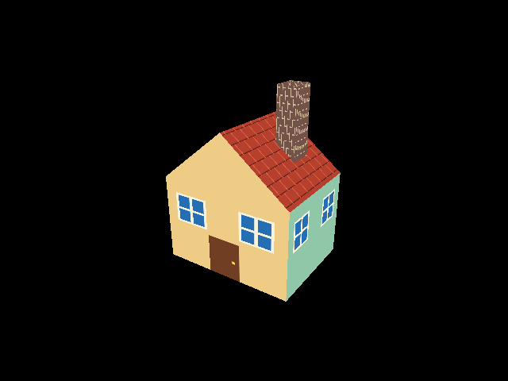

# SoftRenderer

A C++17 software rasterizer that implements a 3D rendering pipeline on the CPU. It transforms and shades vertices, clips primitives, rasterizes triangles, tests depth, and writes pixels to a framebuffer. Win32 displays the finished framebuffer and handles camera input; the rasterization itself does not use a graphics API.



The current demo loads a textured house exported from Blender as an OBJ. Its 28 triangles and 512 × 512 texture atlas exercise model import, UV interpolation, texture sampling, and depth testing. The scene uses full ambient illumination to show the texture atlas without directional-light variation.

## Graphics pipeline

```text
Indexed vertices → vertex shader / MVP transform → homogeneous clipping
    → perspective divide / viewport transform → triangle rasterization
    → perspective-correct interpolation → fragment shader → depth test → framebuffer
```

- **Clipping and culling:** Sutherland–Hodgman clipping against the homogeneous view volume, followed by retriangulation and winding-based face culling.
- **Rasterization:** triangle coverage and barycentric interpolation in screen space; UVs, normals, and colors are interpolated using reciprocal `w` to account for perspective.
- **Depth and textures:** a Z-buffer resolves visibility; textures support nearest-neighbor and bilinear filtering with repeat and mirrored wrapping.
- **Lighting:** a programmable vertex/fragment shader interface supports ambient plus Lambertian directional lighting. Normals are transformed by the inverse-transpose model matrix so lighting remains correct under non-uniform scale.
- **Scene input:** OpenGL-style VAO/VBO/EBO interfaces feed indexed geometry to the CPU pipeline. Assimp imports mesh data, node transforms, UVs, normals, and diffuse textures.

The implementation is organized around [pipeline orchestration](gpu/gpu.cpp), [clipping](gpu/clipper.cpp), [rasterization](gpu/raster.cpp), [texture sampling](gpu/texture.cpp), [lighting](gpu/Shader/lightShader.cpp), and [model import](application/model.cpp). The [math module](Math/MathLib.h) provides vector, matrix, projection, and camera-transform operations.

## Build and run

**Requirements:** Windows x64, Visual Studio 2022 with the MSVC v143 C++ toolchain, CMake 3.14 or newer, and Ninja. The current CMake configuration expects Assimp headers, import libraries, and DLLs under [`thirdParty`](thirdParty), including the MSVC Debug and Release binaries named in [CMakeLists.txt](CMakeLists.txt). The house OBJ, MTL, and texture atlas must be present under [`assets/model/blender_house`](assets/model/blender_house).

From the repository root in a Visual Studio developer terminal:

```powershell
cmake -S . -B build -G Ninja -DCMAKE_BUILD_TYPE=Release
cmake --build build --target softRenderer

# The build copies assets beside the executable; run there for relative paths.
Push-Location build
./softRenderer.exe
Pop-Location
```

The build commands were verified with Visual Studio's bundled CMake and Ninja.

Use **W/A/S/D** to move and hold the **right mouse button** while dragging to look around. The build copies the house model and texture atlas beside the executable. The image above is a captured framebuffer from the current scene.
